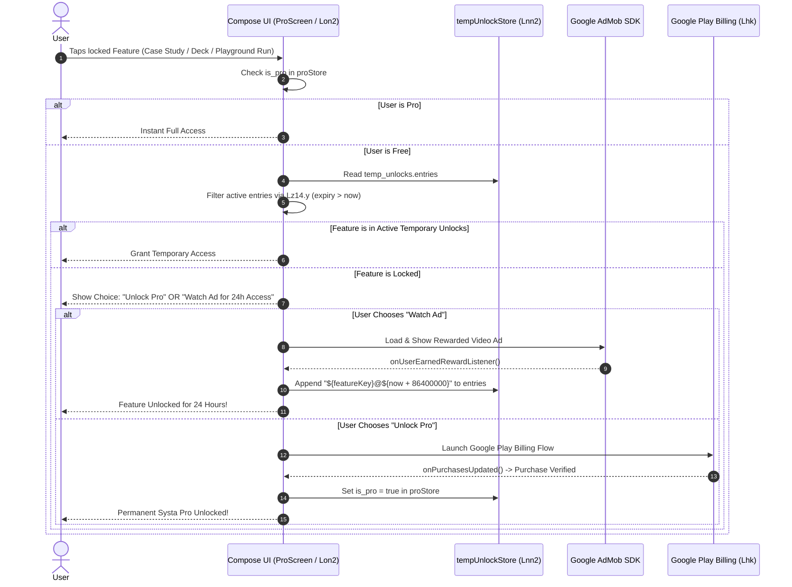

# Architecture & Reverse Engineering Analysis: Systa (Learn System Design)

> **Target Artifact:** `Systa_+Learn+System+Design_2.0_APKPure.xapk`  
> **Package Name:** `com.saimum.systa`  
> **Version Name:** `2.0` (Version Code: `53`)  
> **Target SDK:** `36` (Android 16 preview) | **Min SDK:** `32` (Android 12L) | **Compile SDK:** `37`  
> **Analysis Date:** November 2026  
> **Author:** Senior Software Architect  

---

## Executive Summary

**Systa** is a production-grade, offline-first educational and interview preparation Android application focused on Distributed Systems and Software Architecture. It delivers a rich, interactive learning experience including:
- **103 deep-dive interactive lessons** spanning distributed theory, networking, databases, storage engines, and modern GenAI architectures.
- **32 visual interactive simulators** (e.g., Consistent Hashing rings, LSM-Tree compaction, Token Bucket rate limiting, Saga vs 2PC, Transformer Attention, Raft/Paxos consensus).
- **Interactive System Design Playground**: A topology canvas supporting 60+ architectural node types with a simulation engine that executes topological DAG traversal, critical-path latency computation, saturation modeling, and bottleneck detection.
- **4 Back-of-the-Envelope Engineering Calculators** (QPS to Server Count, Storage Sizing, Bandwidth & CDN Egress, Cache RAM & Hit Rate).
- **Spaced Repetition System (SRS)** flashcard training (SM-2 variant), 46 system design case studies, and 88 interview mock questions.

The app is written in **100% Kotlin** using **Jetpack Compose (Material 3)**. It is entirely self-contained: all curriculum data is embedded locally in encrypted/bundled JSON assets, and all user progression is stored locally across **11 Jetpack Preferences DataStore** instances. There is **no custom backend server or user authentication**. Network access is strictly confined to Google Play Billing (one-time Pro unlock), Google Mobile Ads (AdMob banner, app-open, interstitial, and rewarded ads), Firebase Analytics, and Google Play In-App Review.

---

## 1. Overview & Tech Stack

### 1.1 Tech Stack Matrix

| Component | Implementation Technology | Verified Details in Artifact |
| :--- | :--- | :--- |
| **Language & Runtime** | Kotlin / JVM (Java 17 target) | Compiled with Kotlin coroutines (`DebugProbesKt.bin`), R8 ProGuard full mode |
| **UI Framework** | Jetpack Compose + Material 3 | `androidx.compose.foundation`, `material3`, `ui-tooling-preview` |
| **Navigation** | Jetpack Compose Navigation | Single-activity NavHost (`com.saimum.systa.MainActivity`, `Log4.b`, `Lbq`) |
| **State & Concurrency** | Kotlin Coroutines & `StateFlow` / `Flow` | Extensive usage of `WhileSubscribed(5000)`, `Mutex` (`qh1`), `LinkedHashMap` |
| **Local Persistence** | Jetpack Preferences DataStore | 11 separate DataStore files (e.g. `progress`, `srs`, `playground`, `streak`) |
| **Background Scheduling** | AndroidX WorkManager | `androidx.work.WorkManager`, `androidx.work.Worker` (`ReminderWorker`) |
| **Monetization & Ads** | Google Play In-App Billing + Google Mobile Ads | `BillingClient` v6/v7, AdMob (`ca-app-pub-8539688670389202`), Rewarded/Interstitial/App-Open |
| **App Security & Licensing** | PairIP Application Licensing | `com.pairip.application.Application`, `com.pairip.licensecheck.LicenseActivity` |
| **Analytics & Telemetry** | Firebase Analytics + Google DataTransport | `com.google.android.datatransport.cct`, `com.google.firebase.analytics` |

### 1.2 Entry Points

1. **`com.pairip.application.Application` (`AndroidManifest.xml` line 84)**  
   The primary `Application` class declared in the manifest. Wraps process startup with Google Play integrity and anti-tamper licensing verification.
2. **`com.saimum.systa.MainActivity` (`AndroidManifest.xml` line 85)**  
   The sole interactive entry point (`MAIN` / `LAUNCHER`). Manages locale configuration, edge-to-edge window insets, WorkManager background task scheduling, BillingClient connection, AdMob warm-up, and Jetpack Compose content bootstrapping (`setContent`).
3. **`com.saimum.systa.notify.ReminderWorker` (`AndroidManifest.xml` via WorkManager, classes.dex `Lcom/saimum/systa/notify/ReminderWorker;`)**  
   An `androidx.work.Worker` scheduled with a 7-day initial delay (`0x240c8400` ms) to notify inactive users to maintain their learning streak.
4. **`com.pairip.licensecheck.LicenseActivity` (`AndroidManifest.xml` line 372)**  
   Exported/internal licensing validation trampoline invoked if the app integrity or license verification fails.

---

## 2. Architecture & Modules

The application strictly follows an **Offline-First Clean Architecture** with **Unidirectional Data Flow (UDF)**:

```mermaid
flowchart TD
    subgraph UI_Layer["UI Layer (Jetpack Compose Material 3)"]
        MA["MainActivity (Single Activity Host)"]
        NAV["NavHost (bq.smali / Log4.b)"]
        
        HomeScreen["Home / Catalog Screen"]
        LessonScreen["Lesson & Sim Screen (/lesson/{id}, /sim/{id})"]
        QuizScreen["Quiz Take Screen (/quiz_take/{id})"]
        FlashcardScreen["SRS Review Screen (/deck/{id})"]
        PlaygroundScreen["Topology Canvas & Sim (/playground)"]
        CalcScreen["Calculators Screen (/calc/{id})"]
        ProScreen["Paywall & Unlocks (/pro/{key})"]
    end

    subgraph ViewModel_Layer["State & ViewModel Layer"]
        CatalogVM["Content / Course ViewModels"]
        PlaygroundVM["PlaygroundViewModel (Lpv1)"]
        FlashcardVM["SRS Flashcard ViewModel (Lb43)"]
        StreakVM["Streak ViewModel (Lzi2)"]
        BillingVM["Billing & Pro Manager (Lhk / Lyx1)"]
        TempUnlockVM["Temp Unlock Manager (Lon2 / Lz14)"]
        AdCoordinator["Ad Coordinator & Frequency Capper (Li4 / Lnd5)"]
    end

    subgraph Domain_Algorithms["Domain & Simulation Engines"]
        DAG_Engine["Critical Path DAG Latency Engine (Lus1.a)"]
        Sim_Engine["Playground Flow & Bottleneck Evaluator (Lpv1.o)"]
        SM2_Engine["Spaced Repetition Algorithm (SM-2 Variant)"]
        Calc_Engine["Capacity & Storage Math Engines (Lgp)"]
    end

    subgraph Data_Layer["Data & Persistence Layer"]
        AssetRepo["ContentRepository (Lkz)\nAssetManager reader with Mutex"]
        DataStores["11 Jetpack Preferences DataStores\n(progress, streak, srs, playground, etc.)"]
        WorkMgr["AndroidX WorkManager\n(inactivity_reminder -> ReminderWorker)"]
    end

    subgraph External_Services["External Services (Zero Custom Backend)"]
        PlayBilling["Google Play In-App Billing"]
        AdMob["Google AdMob (App-Open / Interstitial / Rewarded)"]
        Firebase["Firebase Analytics & CCT Transport"]
        PairIP["PairIP License Checker"]
    end

    MA --> NAV
    NAV --> HomeScreen & LessonScreen & QuizScreen & FlashcardScreen & PlaygroundScreen & CalcScreen & ProScreen

    HomeScreen & LessonScreen --> CatalogVM
    PlaygroundScreen --> PlaygroundVM
    FlashcardScreen --> FlashcardVM
    ProScreen --> BillingVM & TempUnlockVM

    PlaygroundVM --> DAG_Engine & Sim_Engine
    FlashcardVM --> SM2_Engine
    CalcScreen --> Calc_Engine
    LessonScreen --> AdCoordinator

    CatalogVM --> AssetRepo
    PlaygroundVM --> DataStores
    FlashcardVM --> DataStores
    StreakVM --> DataStores
    TempUnlockVM --> DataStores
    BillingVM --> DataStores
    AdCoordinator --> DataStores

    MA --> WorkMgr
    BillingVM --> PlayBilling
    AdCoordinator --> AdMob
    MA --> PairIP
    MA --> Firebase
```



### 2.1 Layer Breakdown

1. **Presentation Layer (`androidx.compose`)**:
   - Single Activity architecture hosting a Compose `NavHost` defined in `Lbq`.
   - Composable screens observe immutable `StateFlow` streams exposed by ViewModels.
   - All interactive visual simulators (32 distinct components) are rendered natively via Compose Canvas and vector graphics, not WebViews.
2. **Domain / Computation Layer**:
   - **`Lus1.a`**: Mathematical DAG traversal computing end-to-end latency with cycle suppression.
   - **`Lpv1.o`**: Traffic distribution, bottleneck detection, and drop-rate calculation.
   - **`Lgp`**: Mathematical models for distributed system sizing (QPS, storage, bandwidth, cache).
   - **`Lnd5.z`**: Ad throttle governor preventing interstitial spam.
3. **Data Layer**:
   - **`Lkz` (Content Repository)**: Reads JSON assets on background dispatchers via `AssetManager.open()`, parsing them into memory models with JSON deserializers. Access is synchronized using a coroutine `Mutex` (`qh1`).
   - **Preferences DataStores**: 11 separate DataStore instances managed via Kotlin property delegates (`preferencesDataStore`).

---

## 3. Core User Flows (Code-Traced)

### 3.1 App Startup Flow

| Step | File / Class & Method | Description & Verified Code Details |
| :---: | :--- | :--- |
| **1** | `com.pairip.application.Application` | Native / Java application wrapper checks package signature and Google Play license integrity. |
| **2** | `MainActivity.attachBaseContext` (`classes.dex` #1fdae0) | Reads `app_locale` from SharedPreferences (`Context.getSharedPreferences("app_locale", 0)`). Extracts `language_tag` (defaults to `"en"`). Calls `Locale.forLanguageTag()`, creates a localized `ConfigurationContext`, and passes it to `super.attachBaseContext`. |
| **3** | `MainActivity.onCreate` (`classes.dex` #1fdb64) | Invokes `super.onCreate()`. Configures Edge-to-Edge window insets (`jf0.b` / `kf0.b`). |
| **4** | `MainActivity.onCreate` (`classes.dex` #1fdc48) | **Inactivity Reminder Scheduling:** Instantiates `OneTimeWorkRequest` for `ReminderWorker` with `initialDelay = 0x240c8400` ms (604,800,000 ms = **7 days**). Calls `WorkManager.getInstance().enqueueUniqueWork("inactivity_reminder", REPLACE, workRequest)`. |
| **5** | `MainActivity.onCreate` (`classes.dex` #1fdcc0) | **Billing Client Setup:** Initializes `BillingClient` (`Lak`) and binds listener `Lhk.c`. Queries purchases asynchronously. |
| **6** | `MainActivity.onCreate` (`classes.dex` #1fdec8) | **Ad Coordinator Setup:** Initializes AdMob (`Li4.b`), instantiates `nd5` (Ad frequency store), sets up app-open ad timeout tracker (`0x002dc6c0` ms = 50 minutes). |
| **7** | `MainActivity.onCreate` (`classes.dex` #1fe024) | **Compose Bootstrapping:** Locates decor view, initializes `ComposeView` (`xw`), binds parent composition context, and sets content to root composable `Log4.b`. |
| **8** | `MainActivity.onResume` (`classes.dex` #1fe0e8) | Triggers `Li4.e()` and `Li4.a()` to check if an App-Open ad should be shown (if elapsed real time since last ad exceeds 50 minutes and user is not Pro). Refreshes purchases via `Lhk.c()`. |

### 3.2 Content Exploration & Lesson Study Flow

```
User selects Course 
  -> Navigates to route "course/{courseId}" 
  -> Catalog ViewModel reads cached catalog in Lkz.c (catalog.json)
  -> User selects Topic/Lesson 
  -> Navigates to route "lesson/{lessonId}"
  -> Lkz.h(lessonId) checks in-memory cache (LinkedHashMap g)
       - If missing: reads "content/lessons/{lessonId}.json" via AssetManager.open()
       - Deserializes into Lesson model: title, intro, concepts, diagramType, sim, quiz
  -> UI renders Markdown concepts + Interactive Simulator (sim/{simId})
  -> User takes Quiz: route "quiz_take/{lessonId}"
  -> Upon completion:
       - Score is recorded in progressStore ("progress")
       - completions_since_ad counter incremented in adFrequencyStore
       - Lnd5.z checks: if completions >= 3 AND lastAdAge >= 90 seconds -> Show Interstitial Ad
```

### 3.3 Interactive Playground Topology Simulation Flow

1. **Topology Editing (`PlaygroundViewModel` / `Lpv1`)**:
   - User drags a component onto the canvas -> calls `Lpv1.e(nodeType)` where `nodeType` is an enum value from `Lls1` (e.g., `LOAD_BALANCER`, `CACHE`, `SQL_DATABASE`, `APP_SERVER`).
   - Node is assigned coordinates (`x`, `y`), default replica count (`1`), and default capacity (`customCapacityQps`) and latency (`customLatencyMs`).
   - Connecting two nodes calls `Lpv1.k(fromId, toId)`. Cycle detection and validation run via `Lpv1.l()`.
2. **Simulation Execution (`Lpv1.n`)**:
   - User taps "Run Simulation" with target load (e.g., 5,000 RPS).
   - If free tier user: checks `playgroundRunStore` (`free_used`, `ad_week`, `ad_runs`). If limit reached, user must watch a rewarded video ad or unlock Pro.
   - `Lpv1.o` computes per-node capacity: `nodeCapacity = replicas * customCapacityQps`.
   - Incoming traffic is propagated through edges:
     $$\text{utilization} = \frac{\text{trafficRps}}{\text{nodeCapacity}}$$
     $$\text{if } \text{trafficRps} > \text{nodeCapacity} \implies \text{droppedRps} = \text{trafficRps} - \text{nodeCapacity}, \quad \text{nodeId} \in \text{bottlenecks}$$
   - **Critical-Path Latency (`Lus1.a`)**:
     A memoized recursive DAG traversal computes the worst-case path latency from root client nodes to terminal storage nodes:
     $$\text{Latency}(u) = \text{latency}(u) + \max_{(u, v) \in E} \text{Latency}(v)$$
   - Results are packaged into `SimulationResult` (`Lts1`) and rendered on the canvas with color-coded node health (green, yellow, red bottleneck).

### 3.4 Spaced Repetition (SRS) Flashcard Review Flow

1. User opens a flashcard deck (`route "deck/{deckId}"` or `"deck/all"`).
2. Decks are loaded from `content/flashcards.json`.
3. `srsStore` (`Lnh2`) provides the card review history:
   - For each card: `repetitions`, `interval`, `easeFactor`, and `dueDate` (epoch timestamp).
4. Unreviewed cards or cards with `dueDate <= currentTimeMillis()` are queued.
5. User flips card and selects one of 4 ratings (`b43.smali`):
   - **Again** (Fail): Resets interval to 1 day; card marked to review again soon.
   - **Hard**: Increases interval by small multiplier; reduces ease factor.
   - **Good**: Normal interval progression ($I_{n} = I_{n-1} \times EF$).
   - **Easy**: Increases interval with bonus; raises ease factor.
6. The updated state is committed to `srsStore`. Free users are restricted to 1 deck; unlocking all decks routes to `pro/{unlockKey}`.

### 3.5 Monetization & Temporary Ad Unlocks Flow

The app employs a hybrid monetization strategy combining a **One-Time Lifetime Purchase** with **Rewarded Ad Temporary Unlocks**:



---

## 4. Data Architecture & Storage

### 4.1 Asset Data Files (`/assets/content/`)

All static instructional and reference data is stored in bundled JSON files:

| File Path | Size | Description & Key Schema Fields |
| :--- | :--- | :--- |
| `content/catalog.json` | 24.8 KB | **13 Courses & Topic Directory:** `courses[]` (`id`, `title`, `description`, `icon`, `topics[]` [`id`, `title`, `summary`, `lesson`]). |
| `content/lessons/*.json` | ~4 MB (103 files) | **Curriculum Lessons:** `id`, `title`, `intro`, `objectives[]`, `body`, `examples[]`, `interviewQuestions[]`, `keyIdea`, `sim` (linked simulator), `diagram[][]`, `diagramType`, `concepts[]` (`title`, `body`), `resources[]`, `quiz[]` (`id`, `prompt`, `options[]`, `correct`, `explanation`). |
| `content/cases.json` | 875.8 KB | **46 System Design Case Studies:** `id`, `title`, `subtitle`, `level`, `tags[]`, `readMinutes`, `icon`, `functional[]`, `nonFunctional[]`, `targets[]` (`label`, `value`), `deepDives[]`, `weak`, `weakWhy`, `senior`. |
| `content/interview.json` | 294.2 KB | **88 Mock Interview Questions:** `id`, `category`, `level` (`warmup`, `deepdive`), `question`, `answer`, `keyPoints[]`, `tradeoffs[]`. |
| `content/flashcards.json` | 30.4 KB | **12 Flashcard Decks:** `decks[]` (`id`, `title`, `subtitle`, `icon`, `cards[]` [`id`, `front`, `back`]). |

### 4.2 Local Persistence (Jetpack Preferences DataStores)

The application does **not** create or use a custom SQLite database. (The SQLite/Room tables observed in `classes.dex` belong entirely to internal Google dependencies: `androidx.work` WorkManager, Google Mobile Ads offline pings, and Firebase Analytics).

User state is completely segregated into **11 Jetpack Preferences DataStores**:

```
/data/data/com.saimum.systa/files/datastore/
  ├── progress.preferences_pb           # Lesson completions, quiz scores, celebrated_achievements
  ├── streak.preferences_pb             # Current streak, longest streak, activeDates, freezesAvailable
  ├── case_progress.preferences_pb      # Studied case studies set (studied_cases)
  ├── review.preferences_pb             # In-app review telemetry (review_stage, opens, rated)
  ├── interview_progress.preferences_pb # Answered interview prompts, bookmarks
  ├── playground.preferences_pb         # current_design (JSON), saved_designs (JSON array)
  ├── ad_frequency.preferences_pb       # completions_since_ad, last_interstitial_at, last_ad_day
  ├── srs.preferences_pb                # Flashcard SM-2 review records (intervals, due dates, ease factors)
  ├── pro.preferences_pb                # In-app purchase status: is_pro (Boolean)
  ├── temp_unlocks.preferences_pb       # Set of temporary unlock tokens: entries ("<feature>@<expiryMs>")
  └── playground_runs.preferences_pb    # Free simulation budget tracker: free_used, ad_week, ad_runs
```

---

## 5. APIs & External Integrations

### 5.1 Internal APIs
- **Coroutines & Flow Reactive Bus**: ViewModels expose `StateFlow` streams created via `SharingStarted.WhileSubscribed(5000, 0)` (`Lwh2`), which automatically pause execution 5 seconds after all Compose UI collectors unmount.
- **`Lkz` Asset Bus**: Mutex-guarded (`qh1`) asynchronous reader providing in-memory caching (`LinkedHashMap`) over Android `AssetManager`.

### 5.2 External APIs & Network Endpoints
*The app makes zero network calls to custom backend servers.* External network activity is limited to:

1. **Google Mobile Ads (AdMob)**:
   - AdMob App ID: `ca-app-pub-8539688670389202~...`
   - Interstitial Ad Unit: `ca-app-pub-8539688670389202/1315611313`
   - Rewarded Ad Unit: `ca-app-pub-8539688670389202/6533218324`
   - Protocols: HTTPS / protobuf over Google Mobile Ads SDK endpoints.
2. **Google Play In-App Billing**:
   - `com.android.vending.BILLING` via Google Play Billing Client.
   - Products: One-time in-app purchase (`inapp`) for lifetime Pro unlock.
3. **Google Play In-App Review**:
   - `com.google.android.play.core.review.ReviewManager`: prompts rating dialog once thresholds in `review.preferences_pb` (`opens >= 5`, `playground_runs >= 2`, `rated == false`) are reached.
4. **Google Firebase & Google DataTransport (CCT)**:
   - Uploads anonymous usage analytics and crash metrics to `https://csi.gstatic.com/csi` and Google Play telemetry.
5. **PairIP Anti-Piracy Licensing**:
   - Uses permission `com.android.vending.CHECK_LICENSE` to verify Google Play purchase receipt.
6. **Outbound Intent**:
   - Privacy Policy URL opened in external browser: `https://systa.faithdevs.com/privacy`.

---

## 6. Build Setup & Configuration

### 6.1 Manifest & Platform Configuration (`AndroidManifest.xml`)
- **Package Name:** `com.saimum.systa`
- **SDK Targets:** `minSdkVersion = 32` (Android 12L), `targetSdkVersion = 36` (Android 16 preview), `compileSdkVersion = 37`.
- **Permissions Declared:**
  - `android.permission.INTERNET` (AdMob, Billing, Analytics)
  - `android.permission.ACCESS_NETWORK_STATE` (Check connectivity before ad/billing calls)
  - `android.permission.POST_NOTIFICATIONS` (Android 13+ streak inactivity nudges)
  - `com.android.vending.BILLING` (Google Play In-App Billing)
  - `com.android.vending.CHECK_LICENSE` (PairIP licensing check)
  - `com.google.android.gms.permission.AD_ID` (AdMob identifier)
  - `android.permission.WAKE_LOCK` (WorkManager background tasks)
  - `android.permission.FOREGROUND_SERVICE` (WorkManager service)

### 6.2 Split APK Architecture (.xapk)
The APKPure `.xapk` package is a multi-split bundle designed for dynamic delivery:
- `com.saimum.systa.apk`: The base APK (8.99 MB) containing all code (`classes.dex`), assets (`content/`), and layouts.
- `config.armeabi_v7a.apk` (53.5 KB): ABI-specific native libraries.
- `config.en.apk` (28.8 KB) & `config.fr.apk` (20.6 KB): Localized string resources.
- `config.mdpi.apk` (16.6 KB): Screen density-specific image assets.

---

## 7. Key Logic & Algorithms (Reverse Engineered)

### 7.1 DAG Critical-Path Latency Calculation (`Lus1.a`)

In the system design playground, when a user constructs a multi-tiered architecture (e.g. `Client -> CDN -> API Gateway -> Service -> Cache -> DB`), the app computes the maximum round-trip latency through the system using a **memoized recursive DAG traversal**:

```kotlin
// Exact Kotlin reconstruction of decompiled bytecode in Lus1.a:
fun calculateMaxDownstreamLatency(
    memo: HashMap<String, Int>,
    visited: HashSet<String>,
    nodeMap: LinkedHashMap<String, Node>,
    topology: Topology,
    nodeId: String
): Int {
    // 1. Check dynamic programming memo table
    memo[nodeId]?.let { return it }

    // 2. Cycle detection: prevent infinite loops in cyclic topologies
    if (!visited.add(nodeId)) {
        return nodeMap[nodeId]?.customLatencyMs ?: 0
    }

    val intrinsicLatency = nodeMap[nodeId]?.customLatencyMs ?: 0
    val outgoingEdges = topology.getOutgoingEdges(nodeId)

    // 3. Find critical path: maximum latency among all downstream paths
    var maxChildLatency = 0
    for (edge in outgoingEdges) {
        val childLatency = calculateMaxDownstreamLatency(memo, visited, nodeMap, topology, edge.toNodeId)
        if (childLatency > maxChildLatency) {
            maxChildLatency = childLatency
        }
    }

    // 4. Backtrack cycle guard and memoize total critical-path latency
    visited.remove(nodeId)
    val totalLatency = intrinsicLatency + maxChildLatency
    memo[nodeId] = totalLatency
    return totalLatency
}
```

### 7.2 Ad Frequency Throttling & Anti-Spam Governor (`Lnd5.z`)

To maintain high user retention while maximizing ad monetization, interstitial ads are governed by strict algorithmic rate limiting:

```kotlin
// Exact Kotlin reconstruction of bytecode at Lnd5.z (offset 3ed950):
suspend fun checkAndShowInterstitial(adFrequencyStore: DataStore<Preferences>): Boolean {
    val prefs = adFrequencyStore.data.first()
    val completions = prefs[COMPLETIONS_SINCE_AD] ?: 0
    val lastAdTimestamp = prefs[LAST_INTERSTITIAL_AT] ?: 0L
    val now = System.currentTimeMillis()

    val nextCompletions = completions + 1
    val elapsedSinceLastAd = now - lastAdTimestamp

    // RULE 1: Minimum 3 task/lesson completions required
    // RULE 2: Minimum 90 seconds (90,000 ms) cooldown between interstitials
    if (nextCompletions >= 3 && elapsedSinceLastAd >= 90_000L) {
        adFrequencyStore.edit {
            it[COMPLETIONS_SINCE_AD] = 0
            it[LAST_INTERSTITIAL_AT] = now
        }
        return true // Trigger interstitial presentation
    } else {
        adFrequencyStore.edit {
            it[COMPLETIONS_SINCE_AD] = nextCompletions
        }
        return false // Suppress ad
    }
}
```

### 7.3 Temporary Feature Unlock Parser (`Lz14.y`)

When a user watches a rewarded ad to unlock a locked case study or simulator, the app appends a token formatted as `"${featureKey}@${expirationTimestamp}"` into `tempUnlockStore`. When checking access:

```kotlin
// Exact Kotlin reconstruction of bytecode at Lz14.y (offset 62bea4):
fun getActiveTemporaryUnlocks(storedEntries: Set<String>?): Set<String> {
    val now = System.currentTimeMillis()
    if (storedEntries.isNullOrEmpty()) return emptySet()

    val activeKeys = mutableSetOf<String>()
    for (entry in storedEntries) {
        val atIndex = entry.indexOf('@')
        if (atIndex != -1) {
            val featureKey = entry.substring(0, atIndex)
            val expiryTimestamp = entry.substring(atIndex + 1).toLongOrNull()
            if (expiryTimestamp != null && expiryTimestamp > now) {
                activeKeys.add(featureKey)
            }
        }
    }
    return activeKeys
}
```

---

## 8. Architectural Risks, Tech Debt & Gaps

### 8.1 Security & Monetization Vulnerabilities

1. **Client-Side Pro Verification (High Vulnerability)**  
   The `is_pro` flag is stored as a plain boolean in `pro.preferences_pb` (unencrypted Protobuf file in app private storage). On rooted devices, or using tools like Frida or root file explorers, a user can flip `is_pro = true` in seconds without making an in-app purchase. There is no remote licensing receipt validation server.
2. **PairIP Protection Bypass (Medium Vulnerability)**  
   PairIP wraps `com.pairip.application.Application` and `LicenseActivity`. In pirated APK distributions (such as modified APKPure builds), standard smali patches to `LicenseActivity.onCreate` or hook scripts targeting `ILicenseV2ResultListener` can bypass the Google Play licensing check.
3. **Hardcoded AdMob Publisher & Unit IDs (Low Risk)**  
   Ad units (`ca-app-pub-8539688670389202/1315611313`, etc.) are compiled as raw bytecode strings. While standard for AdMob, dynamic server configuration (e.g. Firebase Remote Config) is absent, making it impossible to rotate ad units or disable ads remotely without releasing a new APK.

### 8.2 Tech Debt & Compatibility Limits

1. **Abnormally High Minimum SDK (`minSdkVersion = 32` / Android 12L)**  
   Requiring Android 12L (API 32) arbitrarily shuts out approximately **25%–30% of global Android users** who remain on Android 10 and 11. Given that Jetpack Compose natively supports down to API 21 (Android 5.0), this high floor is unnecessary tech debt, likely caused by default modern Android Studio template settings.
2. **Static Asset Bundling (Maintenance Inflexibility)**  
   All 103 lessons, 46 cases, and 88 interview questions are bundled inside `/assets/content/`. Any correction, typo fix, or curriculum addition requires a full app compilation and Google Play Store rollout. Implementing a cached remote CMS or Firebase Remote Config delivery would allow instant curriculum updates.
3. **Absence of Cloud Synchronization & User Accounts**  
   Because there is no backend or auth mechanism, user progression (learning streaks, flashcard intervals, quiz scores, and custom playground topologies) is tied exclusively to the local physical device. Clearing app storage or upgrading devices permanently destroys all user progress.

---

## 9. Conclusion

Systa is a well-engineered, modern Android application demonstrating exemplary Jetpack Compose architecture, elegant reactive state management with Coroutines and DataStore, and sophisticated offline algorithmic modeling (graph latency calculation and SM-2 flashcard scheduling). Its core architectural strengths lie in complete offline independence, zero backend operational overhead, and smooth visual interactive simulators. Addressing its client-side purchase vulnerability and adopting cloud sync would elevate it to an enterprise-grade mobile platform.
