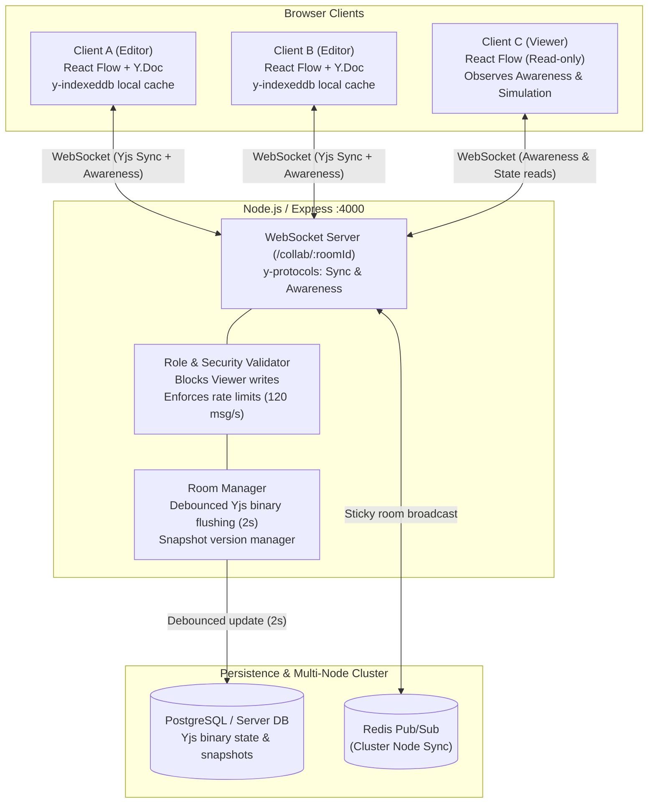

# BluPrnt — Interactive System Design & Distributed Systems Hub

> **BluPrnt** is an offline-first, interactive, production-grade learning and simulation platform for Distributed Systems and System Design. It combines rigorous academic theorems, visual algorithm simulators, real-world case studies, and a drag-and-drop architectural canvas with real-time collaborative editing, bottleneck detection, and critical-path latency calculation.

---

## 🌟 Key Features

### 1. Real-Time Collaborative Playground (Whiteboard)
- **Shared Room Sync**: Click "Share" to generate an invite URL (`/playground?room={roomId}&token={token}`) to edit the same canvas live with teammates under 200ms latency.
- **Role-Based Access Control**:
  - `Owner`: Full management rights (change participant roles, regenerate/revoke invite links, save/restore version snapshots).
  - `Editor`: Add/move/delete nodes and edges, adjust replicas and capacity, trigger shared simulations, and post comments.
  - `Viewer`: Read-only canvas access; can observe live edits, participate in room chat, and run local simulations without modifying the shared document.
  - **Server-Side Security**: Viewer write attempts are strictly rejected on the server by the WebSocket gateway.
- **Live Presence & Cursors**:
  - Live colored cursor tracking with participant names and colors.
  - Active participant avatar stack in the navigation header.
  - Highlight selection ring and author tag on the node another user is currently inspecting or editing.
- **Synchronized Simulation Engine**:
  - When an Editor triggers a simulation, all connected peers deterministically compute results on their local engines.
  - Live broadcast banner displays who triggered the run (e.g. *"Shared Simulation triggered by Alice (50,000 RPS)"*) along with synchronized critical-path latency and bottleneck alerts.
- **Node Comments & Room Chat**:
  - Live multi-user room chat drawer with user color tags.
  - Granular node comments anchored directly to specific component IDs with "Resolve" tracking.
- **Scoped Undo/Redo**:
  - Powered by Yjs `UndoManager` with tracked origins (`localOrigin`).
  - Undoing only reverts *your* local edits, leaving concurrent collaborator updates completely untouched!
- **Version History**:
  - Periodic auto-snapshots and manual point-in-time version saves with one-click restoration.
- **Pro Gating**:
  - Free: Join any room as Editor/Viewer; create 1 active shared room with up to 3 people.
  - Pro: Unlimited shared rooms, up to 10 participants, version history snapshots, and node comments.

### 2. Curriculum & Interactive Lessons
- **Original Content**: 100% freshly written, production-grade lessons covering Caching strategies, Consistent Hashing, Rate Limiting algorithms, and LSM-Tree storage mechanics.
- **Embedded Simulation Lab**: Lessons dynamically embed interactive simulators directly inline without navigating away.
- **Interactive Quizzes**: Formative multiple-choice quizzes with immediate feedback, detailed explanations, confetti celebrations, and local Dexie (IndexedDB) score tracking.

### 3. Interactive Distributed Simulators (8 Built-in)
Built on an extensible registry pattern (`SIMULATOR_REGISTRY`):
1. **Consistent Hashing Ring**: Visual SVG hash ring with virtual nodes (vnodes), clockwise key routing, and minimal migration during node churn.
2. **Token Bucket Rate Limiter**: Reservoir with animated token accumulation, burst allowances, and HTTP 429 throttling telemetry.
3. **LSM-Tree Compaction**: In-memory MemTable, SSTables Level 0 overlapping ranges, and multi-way merge-sort background compaction into Level 1.
4. **Bloom Filter Probabilistic Set**: $k=3$ hash functions over bit array demonstrating 0% false negatives alongside collision-driven false positives.
5. **Saga vs. Two-Phase Commit (2PC)**: Side-by-side comparison of blocking distributed coordinator locks vs. asynchronous compensating workflows.
6. **Raft Consensus & Leader Election**: 5-node cluster simulating randomized election timeouts, split-brain avoidance, heartbeat pulses, and leader crash recovery.
7. **Load Balancer Dispatch Strategies**: Round Robin, Least Connections, and Weighted Capacity routing with dynamic backend node outages.
8. **Cache Eviction (LRU vs. LFU)**: Side-by-side comparison replaying request access traces through fixed-capacity cache slots.

### 4. Back-of-the-Envelope Capacity Calculators
- **QPS to Server Count**: Daily active users, request rates, peak-to-average multipliers, single-server capacity, and N+2 redundancy headroom.
- **Storage Sizing**: Daily ingestion volumes, replication multipliers, metadata/indexing overhead, and multi-year retention cost projections.
- **Bandwidth & CDN Egress**: Peak throughput, average response payloads, CDN cache offload percentages, and origin egress sizing.
- **Cache RAM & Hit Rate**: Pareto 80/20 distribution sizing, Redis memory overhead, fragmentation safety buffers, and database fallthrough QPS.

### 5. Spaced Repetition Flashcards (SuperMemo SM-2)
- Pure mathematical SM-2 interval algorithm (`calculateSm2`).
- Four review ratings: **Again** (1d reset), **Hard** (dampened interval), **Good** (interval * ease factor), **Easy** (bonus interval multiplier).
- Ease factor update: $EF' = EF + (0.1 - (5 - q) \times (0.08 + (5 - q) \times 0.02))$, strictly clamped $\ge 1.3$.
- 3D card flip animation and daily due queue calculation from local IndexedDB.

### 6. Case Studies & Mock Interview Scenarios
- **Case Studies**: Deep architectural requirements, scale targets, deep dives, common mistakes, and Principal Architect level tradeoffs.
- **Mock Interviews**: Real questions asked at tier-1 tech companies with expandable solutions, what interviewers evaluate, and senior tradeoffs.
- **Progress Tracking**: "Mark Studied" and "Bookmark" persisted in Dexie.

### 7. Monetization & Security (BluPrnt Pro)
- **Zero Client Trust**: Pro status is verified on the server via Stripe webhooks (`checkout.session.completed`). The client cannot unlock Pro simply by toggling a boolean.
- **24-Hour HMAC Temporary Tokens**: Cryptographically signed tokens (`<feature>@<expiresAt>.<signature>`) using HMAC-SHA256.
- **No Third-Party Ads**: Strictly ad-free, respectful of user focus.

### 8. PWA & Offline-First Architecture
- Service Worker (`sw.js`) caches app shell, static bundles, and `/content/*.json`.
- Web App Manifest (`manifest.json`) for standalone mobile and desktop installation.
- Dual persistence: edits in collaborative rooms are backed up locally in `y-indexeddb` and merge seamlessly upon reconnect.

---

## 👥 Real-Time Collaboration Architecture

The collaborative whiteboard is powered by **Yjs (CRDT)** over WebSockets with the Awareness protocol, delivering sub-200ms conflict-free state synchronization.



### Document CRDT Model
- `doc.getMap('nodes')`: Maps node IDs to component state (`type`, `label`, `category`, `icon`, `x`, `y`, `replicas`, `capacityQps`, `latencyMs`).
- `doc.getMap('edges')`: Maps edge IDs to `{ id, source, target }`.
- `doc.getMap('settings')`: Holds `targetRps` and `lastRun` simulation broadcasts.
- `doc.getArray('comments')`: Holds threaded node comments `{ id, nodeId, author, text, createdAt, resolved }`.
- `doc.getArray('chat')`: Holds room chat history `{ id, author, color, text, timestamp }`.

---

## 🏗️ Project Structure

```
system_design_prep/
├── ARCHITECTURE.md                  # Comprehensive reverse-engineering analysis of the reference APK
├── PROGRESS.md                      # Phase-by-phase execution tracking
├── bluprnt-client/                  # Frontend Web App (React 18 + TypeScript + Vite)
│   ├── public/
│   │   ├── content/                 # 100% Original Static JSON Curriculum
│   │   ├── manifest.json            # PWA Web App Manifest
│   │   └── sw.js                    # PWA Offline Service Worker
│   ├── src/
│   │   ├── components/
│   │   │   ├── layout/AppShell.tsx  # Responsive sidebar, navigation & header
│   │   │   ├── lesson/QuizRunner.tsx# Confetti quiz runner with score persistence
│   │   │   ├── playground/          # React Flow canvas, Collab cursors, headers & modals
│   │   │   └── simulators/          # 8 visual interactive simulators
│   │   ├── core/
│   │   │   ├── algorithms/          # Pure DAG latency, bottleneck, SM-2, sizing math
│   │   │   ├── collab/              # useCollabSession Yjs hook & presence binding
│   │   │   └── registry/            # 40+ node registry & simulator registry
│   │   ├── db/database.ts           # Dexie IndexedDB local-first storage
│   │   ├── pages/                   # All 9 routing views
│   │   ├── repository/              # ContentRepository (lazy fetch + in-memory cache)
│   │   ├── stores/                  # Zustand theme & progress stores
│   │   └── tests/                   # Vitest unit & integration test suite (23 tests)
└── bluprnt-server/                  # Minimal Backend (Node.js/Express + TypeScript)
    ├── src/
    │   ├── collab/                  # roomManager & wsHandler (WebSocket + Yjs sync)
    │   ├── core/tokenSigner.ts      # HMAC-SHA256 24h token generator & verifier
    │   ├── db/db.ts                 # Persistent authoritative store
    │   ├── routes/                  # Stripe checkout, Collab rooms, and cloud sync
    │   └── index.ts                 # Express & WebSocket HTTP server
```

---

## 🚀 Setup & Execution

### Prerequisites
- Node.js $\ge 18$ (Tested on Node v26)
- npm $\ge 9$

### 1. Run Frontend Client
```bash
cd bluprnt-client
npm install
npm run dev
```
Open [http://localhost:5173](http://localhost:5173) in your browser.

### 2. Run Backend Server (Express + WebSocket Gateway)
```bash
cd bluprnt-server
npm install
npm run dev
```
Server runs on [http://localhost:4000](http://localhost:4000), serving both REST APIs and collaborative WebSockets at `ws://localhost:4000/collab`.

### 3. Run Unit & Integration Test Suite
```bash
cd bluprnt-client
npm test
```
Runs 23 deterministic Vitest unit & integration tests covering:
- Multi-client collaborative CRDT convergence (Strong Eventual Consistency)
- Yjs <-> React Flow binding & scoped origin UndoManager isolation
- Server-side role permission checks (Owner vs Editor vs Viewer)
- Cycle-safe recursive DAG critical path calculations
- Multi-tier bottleneck and traffic saturation evaluations
- SuperMemo-2 spaced repetition interval and ease factor updates
- Capacity sizing equations (QPS, Storage, Bandwidth, Cache RAM)

### 4. Build for Production
```bash
# Build Client
cd bluprnt-client
npm run build

# Build Server
cd bluprnt-server
npm run build
```
Client output is placed in `bluprnt-client/dist/`, ready for deployment to any static CDN or edge platform.

---

## ⚡ Universal Auto-Streaming Simulator Engine (Registry-Driven)

All 18 simulators stream continuous traffic immediately upon opening, removing all manual click-to-send friction.

### Core Universal Architecture
- **Zero Click-to-Send**: Auto-starts at module-specific rate. Switching modes or tweaking parameters keeps stream flowing while resetting internal algorithm state.
- **Top Bar Controls**: Back link, simulator title, linked lesson pill, Play/Pause (`Space`) and Reset (`R`).
- **Grouped Traffic Card**: Granular slider and steppers (- / +) with live labels, plus a **Bursty Traffic** toggle (alternating quiet gaps and 4x spikes).
- **Visualization Card**: Flow diagram (`Source ➔ Module ➔ Target`), center node circular gauge with live primary metric, and a **last 44 requests** outcome strip (newest right) utilizing **color AND shape/pattern** (circle, square, triangle, diamond, cross, slash) for 100% color-blind accessibility.
- **Exactly 3 Stat Tiles**: Strict KPI format per module (e.g. Inbound, Pass Rate, Latency).
- **Failure Injection**: Mid-stream failure injection buttons (kill nodes, degrade latencies, partition network, crash leaders).

### How to Add a New Simulator in 10 Minutes

Adding a new algorithm simulator requires **zero UI screen code**! You only need:
1. A pure `SimulatorLogic` class implementing `SimulatorLogic<TState>` in `src/simulators/modules/`.
2. A `SimulatorDefinition` object in `src/simulators/registry.ts`.

#### Step 1: Implement `SimulatorLogic`
```typescript
// src/simulators/modules/myAlgorithm.ts
import { SimulatorLogic, OutcomeDef, StatTileDef, RequestPayload, SimulatorDefinition } from '../engine/types';

export const MY_OUTCOMES: OutcomeDef[] = [
  { id: 'success', label: 'Success (200 OK)', color: '#10b981', shape: 'circle' },
  { id: 'throttled', label: 'Throttled (429)', color: '#ef4444', shape: 'cross' },
];

export class MyAlgorithmLogic implements SimulatorLogic {
  private count = 0;
  private throttled = 0;

  init(params: Record<string, any>, modeId: string) {
    this.reset();
  }

  reset() {
    this.count = 0;
    this.throttled = 0;
  }

  onRequest(req: RequestPayload, now: number): OutcomeDef {
    this.count++;
    if (this.count % 10 === 0) {
      this.throttled++;
      return MY_OUTCOMES[1];
    }
    return MY_OUTCOMES[0];
  }

  tick(dtMs: number, now: number) {
    // Background timers / drains
  }

  getCenterMetric() {
    return { label: 'Quota', value: `${this.count % 10} / 10`, percentage: (this.count % 10) * 10 };
  }

  getStats(): [StatTileDef, StatTileDef, StatTileDef] {
    return [
      { label: 'Total Inbound', value: this.count, color: '#38bdf8' },
      { label: 'Pass Rate', value: `${Math.round(((this.count - this.throttled) / Math.max(1, this.count)) * 100)}%`, color: '#10b981' },
      { label: 'Throttled', value: this.throttled, color: '#ef4444' },
    ];
  }

  getState() { return { count: this.count }; }
}

export const myAlgorithmDefinition: SimulatorDefinition = {
  id: 'my-algorithm',
  title: 'My Custom Distributed Algorithm',
  description: 'Simulates custom distributed routing behavior in continuous real-time streaming.',
  defaultRate: 20,
  maxRate: 60,
  modes: [
    { id: 'mode_a', label: 'Mode A', explanation: 'Plain English explanation of algorithmic behavior for Mode A.' },
  ],
  params: [],
  outcomes: MY_OUTCOMES,
  createLogic: () => new MyAlgorithmLogic(),
};
```

#### Step 2: Register in `src/simulators/registry.ts`
```typescript
import { myAlgorithmDefinition } from './modules/myAlgorithm';

export const SIMULATOR_REGISTRY: SimulatorDefinition[] = [
  ...
  myAlgorithmDefinition,
];
```
The generic `<SimulatorScreen definition={myAlgorithmDefinition} />` automatically renders the entire interactive UI, charts, controls, and accessibility strips immediately!

