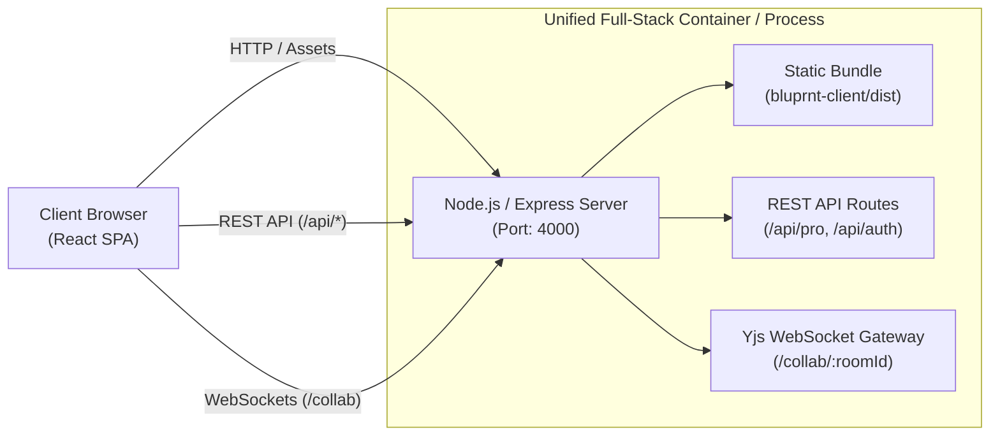

# BluPrnt — Interactive Distributed Systems & System Design Studio

[](#)
[](#)
[](LICENSE)
[](#-single-instance-deployment-guide)

> **BluPrnt** is an all-in-one, interactive, production-grade learning, simulation, and whiteboard studio for Distributed Systems and System Design.
> It unifies rigorous computer science algorithms, real-world case studies, capacity sizing calculators, and a drag-and-drop architectural canvas with **real-time collaborative CRDT editing**, **discrete-event $M/M/c$ queuing simulation**, **chaos fault injection**, **reliability linting**, and **18 dual-mode algorithm visualizers**.

---

## 🎯 What is BluPrnt About?

Mastering distributed systems and system design interviews traditionally suffers from high abstraction: static diagrams in blogs, complex mathematical formulas without visual feedback, and disconnected textbooks.

**BluPrnt transforms theoretical distributed systems concepts into living, interactive models:**
1. **Interactive Topology Canvas**: Build complex microservice clusters, scale replicas up/down, inject simulated traffic, and immediately observe packet flow, bottlenecks, and P99 latency.
2. **Chaos & Reliability Engineering**: Intentionally kill nodes, inject 250ms network latency spikes, sever links, and let our built-in Architecture Linter audit your design for Single Points of Failure (SPOFs).
3. **Deep Algorithmic Visualizers**: Inspect the internal state machines of Raft consensus, Consistent Hashing rings, LSM-Tree compactions, Token Buckets, and Gossip protocols in real-time.
4. **Single-Instance Deployment**: Designed as a unified full-stack service—deploy your UI, REST API, and collaborative WebSockets together on **1 single instance** with zero friction.

---

## 🚀 Key Modules Overview

```
bluprnt/
├── 1. Topology Playground & Whiteboard (React Flow + Yjs CRDT + M/M/c Sim)
├── 2. Vertical Machine Sizing Tiers (Micro, Standard, Compute, Memory, Metal)
├── 3. Chaos Studio & Fault Injection (Surge, Kill Node, Cut Link, Jitter, Heal)
├── 4. Production Reliability Linter & SPOF Auditor (A+ to F Grading)
├── 5. Architecture Incident Challenge Arena (Black Friday, Zero-SPOF, Low-Latency)
├── 6. Cloud Infrastructure Bill & Cost Estimator (Real-time $/mo estimation)
├── 7. 18 Dual-Mode Distributed Algorithm Simulators (Streaming & Step-Through)
├── 8. Production Case Studies (Netflix, Uber, Stripe, TinyURL, Twitter)
├── 9. Senior Mock System Design Interviews (Step-by-step rubrics & solutions)
├── 10. Back-of-the-Envelope Capacity Calculators (QPS, Storage, Bandwidth, Cache)
├── 11. Spaced Repetition Flashcards (SuperMemo SM-2 Engine + Dexie IndexedDB)
├── 12. Interactive Curriculum & Formative Quizzes (Self-paced masterclass)
├── 13. BluPrnt Pro Security & Monetization (Stripe Webhooks & 24h HMAC Tokens)
└── 14. Offline PWA & Local Storage (Service Worker & IndexedDB)
```

---

## 🔍 In-Depth Module Tour

### 1. Collaborative Topology Playground (Whiteboard)
- **42 Enterprise Component Palette**: Spanning 7 distinct infrastructure tiers:
  - *Ingress & Clients*: Web/Mobile, CDN, Anycast DNS, Reverse Proxy, API Gateway, Load Balancer.
  - *Compute & Microservices*: Go/Node/Java API Services, Serverless Functions, Batch Workers, GraphQL Gateway.
  - *Caching*: Redis Cluster, Memcached, Local In-Memory Cache, EVCache.
  - *Databases (SQL & NoSQL)*: PostgreSQL Primary/Replica, MySQL, Cassandra, MongoDB, DynamoDB, CockroachDB.
  - *Event Streaming & Queues*: Apache Kafka, RabbitMQ, AWS SQS, Redis Streams.
  - *Storage & Edge*: S3 Object Storage, HDFS, Block Storage.
- **Real-Time Multi-User Collaboration**:
  - Powered by **Yjs (CRDT)** over WebSockets via y-protocols sync and awareness.
  - Instant room sharing with tokenized links (`/playground?room={id}&token={token}`).
  - Role-Based Access Control (**Owner**, **Editor**, **Viewer**) with server-side write rejection for Viewers.
  - Live cursor tracking with participant avatars, names, and remote node selection outlines.
  - Scoped Undo/Redo (`UndoManager` scoped to local client origin).
  - Multi-user room chat drawer and granular node-anchored comment threads.
- **Discrete-Event $M/M/c$ Queuing Simulation**:
  - Computes deterministic cluster capacity, node utilization percentage, and dropped requests.
  - Calculates end-to-end P99 latency across the directed acyclic graph (DAG) critical path.
  - Dynamic bottleneck indicator highlighting the exact component choking the architecture.
- **Animated Bezier Edges & 3-Way Disconnection**:
  - Flowing glowing packet streams scaled dynamically to traffic volume.
  - Elevated metric badges (`RPS • Latency`) elevated cleanly above edge lines without handle collision.
  - **3 Easy Ways to Disconnect Edges**:
    1. Hover over any edge badge and click the red `×` button.
    2. Click any edge to select it and press `Backspace` or `Delete`.
    3. Open the right Inspector sidebar and click the `×` button next to any Upstream/Downstream connected node.

---

### 2. Vertical Machine Sizing & Instance Tiers
Fine-tune each individual node beyond horizontal replicas by adjusting its virtual hardware specifications:
- **T1: Micro** (1 vCPU, 1 GB RAM, $0.015/hr) — Best for lightweight ingress and background workers.
- **T2: Standard** (2 vCPU, 4 GB RAM, $0.040/hr) — Balanced general-purpose services.
- **T3: Compute-Optimized** (4 vCPU, 8 GB RAM, $0.090/hr) — Low-latency compute, encoding, or encryption.
- **T4: Memory-Optimized** (8 vCPU, 32 GB RAM, $0.180/hr) — High-throughput Redis caches and in-memory stores.
- **T5: Bare Metal** (32 vCPU, 128 GB RAM, $0.720/hr) — Massive primary database nodes and analytical engines.
*Hardware upgrades automatically multiply base capacity QPS, lower processing latency, and recalculate cloud infrastructure bills.*

---

### 3. Chaos Studio & Distributed Fault Injection
Stress-test your system's resilience in real-time under adverse production conditions:
- **Traffic Spike (3x Surge)**: Simulates sudden virality or flash sales, pushing downstream nodes beyond provisioned capacity.
- **Node Kill (Hardware Crash)**: Instantly crashes a selected component to verify automatic failover and downstream error propagation.
- **Sever Link (Network Partition)**: Cuts network communication between two specific tiers to test circuit breakers and fallback caches.
- **Latency Jitter (+250ms Injection)**: Injects erratic network delay to reveal cascading timeout failures and thread exhaustion.
- **Heal All**: One-click recovery that restores healthy telemetry, drains backpressure, and clears faults.

---

### 4. Production Reliability Linter & SPOF Auditor
An automated architectural auditor inspecting your canvas topology and grading it from **A+ to F**:
- **Single Point of Failure (SPOF) Detection**: Flags un-replicated databases or gateways operating with 1 replica on critical paths.
- **Unshielded Client Ingress**: Warns when raw client traffic directly reaches internal database or backend tiers without a reverse proxy or API gateway.
- **Missing Cache Tier**: Recommends caching layers when read-heavy workloads repeatedly hammer relational databases.
- **Queue Backpressure Warnings**: Catches fast producers directly connected to slow synchronous consumers without a message broker buffer.

---

### 5. Architecture Incident Challenge Arena
Gamified incident response scenarios where you fix broken production setups under strict constraints:
- **Scenario 1: Black Friday Stampede**: Ingress surges to 150,000 RPS. Re-architect the topology with caching, CDNs, and horizontal autoscaling to achieve 0 dropped requests.
- **Scenario 2: Zero-SPOF Core Banking Ledger**: Eliminate all single points of failure, introduce read replicas and circuit breakers, and maintain an **A+** reliability rating.
- **Scenario 3: Ultra-Low-Latency Ride Dispatch**: Optimize end-to-end critical-path latency to under 35ms across geospatial matching and caching layers.

---

### 6. Cloud Infrastructure Bill & Cost Estimator
- Continuously approximates monthly cloud provider infrastructure spend (AWS/GCP/Azure equivalent).
- Dynamically factors in:
  - Aggregate vCPUs across all nodes and tiers.
  - Total RAM allocations across cache nodes and databases.
  - Data egress bandwidth charges based on traffic volume and payload sizes.
  - Projected monthly total with actionable cost-optimization recommendations.

---

### 7. 18 Dual-Mode Distributed Algorithm Visualizers
Every algorithm is equipped with a **Dual-Mode Control Suite**:
1. **Continuous Auto-Streaming Flow**: Live synthetic traffic generation showing continuous operations, queue metrics, and packet flow.
2. **Step-by-Step Debugger**: Granular forward/backward stepping with custom user payload injection to inspect algorithmic invariants line-by-line.

| # | Algorithm Visualizer | Key Mechanics Demonstrated |
|---|----------------------|----------------------------|
| 1 | **Consistent Hashing Ring** | 360° SVG hash ring, virtual nodes (vnodes), clockwise key assignment, minimal key migration on node addition/removal. |
| 2 | **Token / Leaky Bucket** | Continuous token replenishment, burst capacity allowance, token consumption, and HTTP 429 Rate Limit drop metrics. |
| 3 | **LSM-Tree Compaction** | In-memory MemTable, Write-Ahead Log (WAL), immutable SSTables, and background multi-way merge compaction. |
| 4 | **Bloom Filter Probabilistic Set** | $k=3$ Murmur-based hash functions, bit array indexing, 100% true negatives, and collision-driven false positive probability. |
| 5 | **Saga vs. Two-Phase Commit (2PC)** | Blocking 2PC coordinator lock phases vs. asynchronous orchestrator/choreographed Saga compensating transactions. |
| 6 | **Raft Consensus & Leader Election** | 5-node cluster, randomized election timeouts, split-brain avoidance, heartbeat replication, and dynamic leader failover. |
| 7 | **Load Balancer Dispatch** | Round Robin, Weighted Round Robin, Least Connections, and IP Hash algorithms with backend server health toggles. |
| 8 | **Cache Eviction Strategies** | Side-by-side comparison of Least Recently Used (LRU), Least Frequently Used (LFU), and FIFO eviction queues. |
| 9 | **Quorum Replication ($N, W, R$)** | Strong consistency ($W + R > N$) vs. eventual consistency, read repair, and stale replica detection. |
| 10 | **Database Sharding Engine** | Hash-based vs. Range-based key routing, shard directory lookup, and hot-shard rebalancing. |
| 11 | **Storage Indexes (B+ Tree vs LSM)** | B+ Tree in-place random writes & balanced branch splits vs LSM-Tree sequential append-only writes & read amplification. |
| 12 | **Circuit Breaker Pattern** | Closed (healthy), Open (fail-fast tripping), and Half-Open (canary probing) state machine transitions. |
| 13 | **Retry with Exponential Backoff & Jitter** | Standard retry vs. Exponential Backoff ($t \times 2^i$) vs. AWS Full Jitter algorithm preventing thundering herd stampedes. |
| 14 | **Message Queue & Consumer Groups** | FIFO message ordering, offset acknowledgments, partition assignment across consumer groups, and dead-letter queues (DLQ). |
| 15 | **CDN Edge & Anycast GeoDNS** | Latency-based Anycast routing, edge cache hits ($~10\text{ms}$), cache misses, and origin shield offload telemetry. |
| 16 | **Gossip Protocol Dissemination** | Epidemic infection model, peer-to-peer heartbeat state dissemination, peer discovery, and eventual convergence. |
| 17 | **Auto-Scaling Elastic Compute** | Horizontal Pod Autoscaler (HPA) metrics, target CPU/QPS thresholds, scale-out delays, and cool-down stabilization windows. |
| 18 | **Idempotency Key Pipeline** | Unique token deduplication header (`Idempotency-Key`), atomic atomic reservation, in-flight locking, and cached response replaying. |

---

### 8. Production Case Studies
Comprehensive architectural breakdowns of Tier-1 internet scale platforms:
- **Netflix**: Video streaming CDN (Open Connect Edge OCAs), Zuul Gateway routing, EVCache Memcached clusters, and Cassandra metadata store.
- **Uber**: Geospatial H3 hexagonal indexing, Dispatch Matcher engine, high-throughput driver location ingestion via Kafka, and Ringpop service mesh.
- **Stripe**: Idempotency proxy layer, zero-loss double-entry immutable ledger, distributed consensus, and transactional outbox webhook dispatcher.
- **Global URL Shortener (TinyURL)**: 100:1 read-to-write ratio, Base62 distributed counter encoding, Redis caching, and KGS pre-generation.
- **Twitter / X Timeline**: Fan-out-on-write (push) for regular users vs fan-out-on-read (pull) for celebrity accounts, Redis timeline caches, and Snowflake IDs.

---

### 9. Senior Mock System Design Interviews
Structured, real-world mock interview simulations modeled after Principal/Staff technical evaluations:
- **Step-by-Step Interactive Solution Reveal**: Requirements Clarification $\to$ Back-of-the-envelope estimation $\to$ High-Level Design $\to$ Deep Dives $\to$ Bottlenecks & Edge Cases.
- **Interview Rubric & Evaluation Criteria**: Exactly what interviewers look for across Communication, Architecture, Trade-Offs, and Resilience.
- **Senior Trade-Off Callouts**: Deep exploration of alternative database selections, consistency models, and multi-region replication pitfalls.

---

### 10. Back-of-the-Envelope Capacity Calculators
- **QPS to Server Count**: Daily active users (DAU), average requests/user, peak multiplier, per-instance capacity, and $N+2$ redundancy overhead.
- **Storage Sizing**: Daily record ingestion, retention period, write amplification, replication factors, and multi-year disk volume forecasts.
- **Bandwidth & CDN Egress**: Peak request rates, average payload size, CDN offload percentage, and internal network interface requirements.
- **Cache RAM Pareto (80/20 Rule)**: Working set sizing, 80/20 traffic distribution, metadata overhead buffer, and database cache-miss fallthrough QPS.

---

### 11. Spaced Repetition Flashcards (SuperMemo SM-2)
- Algorithmic spaced repetition flashcards for system design concepts, theorems, and distributed mechanics.
- **Mathematically Pure SM-2 Implementation**:
  - Quality ratings: `Again` (Reset), `Hard` (Dampened), `Good` (Standard interval), `Easy` (Bonus interval).
  - Dynamic Ease Factor formula:
    $$EF' = EF + (0.1 - (5 - q) \times (0.08 + (5 - q) \times 0.02)) \quad (\text{clamped } \ge 1.3)$$
- Interactive 3D flip card UI with daily due queues and local Dexie (IndexedDB) persistence.

---

### 12. Interactive Curriculum & Formative Quizzes
- Comprehensive self-paced masterclass covering foundational to advanced distributed systems concepts.
- Embedded inline simulators allow testing concepts directly inside lesson reading flows without navigation.
- Multiple-choice formative quizzes with immediate feedback, detailed rationales, and progress tracking.

---

### 13. BluPrnt Pro Security & Monetization
- **Zero Client Trust**: Pro status is verified on the backend via Stripe webhooks (`checkout.session.completed`).
- **Cryptographic 24-Hour HMAC Access Tokens**:
  - Temporary access tokens (`<feature>@<expiresAt>.<hmacSignature>`) signed with HMAC-SHA256.
  - Server-side verification ensures tokens cannot be forged or tampered with on the client.
- **Clean Experience**: Strictly 100% ad-free.

---

### 14. Offline-First PWA Architecture
- Fully configured Progressive Web App with `manifest.json` and standalone installation support.
- Service Worker (`sw.js`) caches application shells, static assets, and simulation presets.
- Client state persisted locally in Dexie (IndexedDB) and `y-indexeddb` for offline canvas editing with zero data loss.

---

## ⚡ Single-Instance Deployment Guide

> **Deploying 1 Single Instance**: You do **NOT** need to deploy two separate instances (frontend + backend).
> Our unified full-stack architecture bundles the Vite React client, REST API endpoints (`/api/*`), and real-time Yjs WebSockets (`/collab`) into **one single process running on one single port**.



---

### Option 1: Docker (Single Container) — *Recommended*

The included multi-stage `Dockerfile` compiles the client, builds the server, and serves everything on port `4000`:

```bash
# 1. Build the single container image
docker build -t bluprnt .

# 2. Run the single container
docker run -d -p 4000:4000 -e PORT=4000 --name bluprnt-app bluprnt
```
Open `http://localhost:4000` in your browser. All pages, APIs, and WebSockets work seamlessly out of the box!

---

### Option 2: Render (1-Click Single Web Service)

The repo includes [`render.yaml`](render.yaml) for instant zero-configuration deployment:
1. Connect your GitHub repository to [Render](https://dashboard.render.com).
2. Create a new **Web Service** from Blueprint (or select `render.yaml`).
3. Render automatically runs:
   - **Build Command**: `npm install && npm run build`
   - **Start Command**: `npm start`
4. Set the environment variable `PORT` to `10000` (Render's default) or leave blank.

---

### Option 3: Railway (1-Click Single Web Service)

The repo includes [`railway.json`](railway.json) configured with the Nixpacks builder:
1. In Railway, click **New Project** $\to$ **Deploy from GitHub repo**.
2. Railway detects the configuration and executes:
   - **Build Command**: `npm install && npm run build`
   - **Start Command**: `npm start`
3. Railway injects `PORT` automatically. Your entire app (UI + API + WebSockets) runs as **1 service**.

---

### Option 4: Vercel (Single-Instance SPA)

The repo includes [`vercel.json`](vercel.json):
1. Import your GitHub repository into [Vercel](https://vercel.com).
2. Framework Preset: **Vite**.
3. Build Command: `npm run build` (or `npm run build:client`).
4. Output Directory: `bluprnt-client/dist`.
5. The full offline canvas, 18 simulators, case studies, calculators, and flashcards run with zero external server dependencies! (To enable live multi-user collaboration rooms, point `VITE_COLLAB_WS_URL` to your unified server or Railway instance).

---

### Option 5: Local Single-Command Run

Run both packages together on your local machine:

```bash
# 1. Install all monorepo dependencies
npm install

# 2. Build both client and server
npm run build

# 3. Start the unified production server
npm start
```
The server will print:
```
[BluPrnt Unified Server] Listening on port 4000
[BluPrnt Unified Server] Serving React client from /path/to/bluprnt-client/dist
[BluPrnt Unified Server] WebSocket Gateway mounted on /collab
```

---

## 🛠️ Local Development Setup

For live development with hot-module reloading (HMR):

```bash
# 1. Clone the repository
git clone https://github.com/Sushant0999/blu_prnt.git
cd blu_prnt

# 2. Install dependencies across all workspaces
npm install

# 3. Start development servers concurrently
npm run dev
```
- **Vite Client HMR Dev Server**: `http://localhost:5173` (proxies `/api` and `/collab` to port 4000)
- **Node.js Express & WebSocket Gateway**: `http://localhost:4000`

---

## 🧪 Test Suite & Verification

BluPrnt includes 11 comprehensive Vitest test suites verifying algorithmic correctness, DAG latency math, CRDT binding, and simulator definitions of done:

```bash
# Run all 117 unit and integration tests
npm test
```

Test coverage includes:
- `sm2.test.ts`: SuperMemo SM-2 interval expansion, ease factor clamping, and repetition counts.
- `sizingMath.test.ts`: Mathematical verification of capacity, storage, and egress calculators.
- `dagLatency.test.ts`: Critical-path DAG latency calculations and topological sorting.
- `bottleneck.test.ts`: $M/M/c$ queuing simulation, node utilization, and dropped request identification.
- `architectureLinter.test.ts`: Detection of Single Points of Failure (SPOF) and topology health grading.
- `trafficGenerator.test.ts`: Synthetic packet generation, Poisson distributions, and streaming timers.
- `simulatorModules.test.ts`: Algorithmic step invariants across all distributed modules.
- `registryDefinitionOfDone.test.ts`: Verifies all 18 simulators implement both continuous flow and step-through debugger interfaces.
- `collabBinding.test.ts` & `collabConvergence.test.ts`: Yjs CRDT convergence, awareness presence, and node translation synchronization.

---

## 📁 Repository Structure

```
blu_prnt/
├── Dockerfile                   # Multi-stage production container (1-instance)
├── render.yaml                  # 1-click deployment blueprint for Render
├── railway.json                 # 1-click deployment configuration for Railway
├── vercel.json                  # Single-instance SPA deployment configuration
├── package.json                 # Monorepo root workspace orchestrator
├── scripts/
│   └── dev.js                   # Cross-platform concurrent local dev runner
├── bluprnt-client/              # React 18 + Vite + Tailwind frontend
│   ├── public/                  # Static assets & PWA manifest
│   ├── src/
│   │   ├── components/
│   │   │   ├── playground/      # Whiteboard, AnimatedEdge, Nodes, Toolbars, Chaos
│   │   │   ├── simulators/      # Algorithmic interactive visualizers
│   │   │   └── navigation/      # Header, Sidebar, Room status
│   │   ├── core/
│   │   │   ├── algorithms/      # SM-2 math, DAG latency, Bottleneck engine
│   │   │   ├── collab/          # Yjs CRDT hooks, Awareness, WebSocket binding
│   │   │   └── db/              # Dexie IndexedDB schemas
│   │   ├── pages/               # Playground, Simulators, Case Studies, Quizzes
│   │   ├── simulators/          # 18 Modular algorithm definitions & registry
│   │   └── tests/               # 11 Vitest test suites (117 tests)
│   └── vite.config.ts           # Vite build & proxy configuration
└── bluprnt-server/              # Unified Express & WebSocket Backend
    ├── src/
    │   ├── index.ts             # Express server + SPA static serving + WS gateway
    │   ├── collab/              # Yjs room management, binary sync, rate limiting
    │   └── routes/              # Pro verification, Stripe webhooks, HMAC tokens
    └── tsconfig.json
```

---

## 📄 License

This project is licensed under the [MIT License](LICENSE).
Built with ❤️ for distributed systems engineers and system design interview candidates worldwide.
