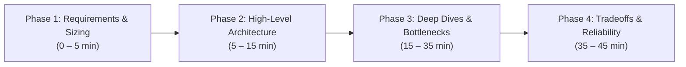
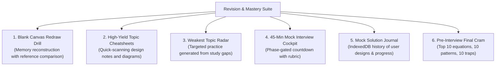
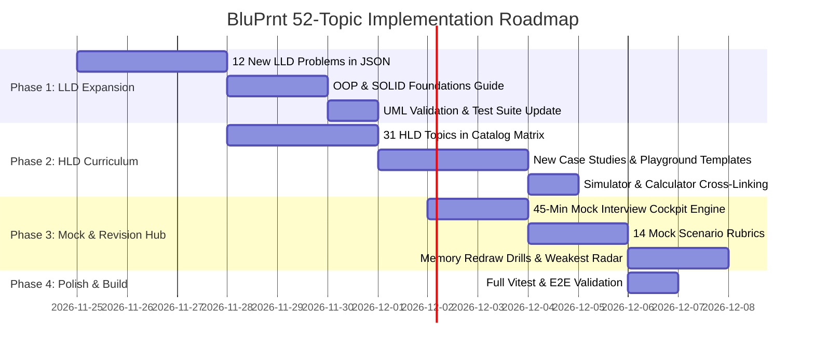

# BluPrnt System Design Curriculum & Expansion Master Plan
## Comprehensive Architectural Audit, 52-Topic Mapping, Mock Interview Engine & Revision Roadmap

---

## Executive Summary

This report establishes the complete architectural blueprint and execution roadmap for integrating the user's master list of **52 unique system design topics** (**31 High-Level Design (HLD)** and **21 Low-Level Design (LLD)**), along with **14 Mock Interview Exercises** and **6 Revision Activities**, into the **BluPrnt** platform.

BluPrnt already provides a rich foundation:
- An interactive **Collaborative React Flow Topology Canvas** with $M/M/c$ queuing simulation and chaos injection (`/playground`).
- An **LLD Studio** with interactive UML class diagramming, GoF patterns, and problem bank (`/lld`).
- **18 Universal Distributed Algorithm Simulators** with dual auto-streaming and step-through modes (`/simulate`).
- **Back-of-the-envelope capacity calculators** (`/calculators`).
- **Spaced Repetition (SM-2) flashcards** (`/flashcards`).
- **Senior Case Studies** (`/cases`) and **Mock Scenarios** (`/interview`).

However, the existing curriculum currently holds only **4 HLD lessons**, **3 case studies**, **3 interview prompts**, and **6 LLD problems**. This master plan details how to systematically scale BluPrnt to encompass the full **52-topic syllabus** without bloat, maintaining 100% test coverage, strict UML schema validation, and high pedagogical engagement.

---

## 1. Master Scope & Inventory

The master taxonomy comprises four distinct tiers:

```
BluPrnt Master Curriculum (52 Topics + 20 Practice Modules)
├── 1. High-Level Design (HLD) — 31 Unique Topics
│   ├── Group A: Distributed Foundations & Metrics (Topics 1, 2, 6, 7, 8, 9)
│   ├── Group B: Ingress, Network & Protocols (Topics 3, 12, 13, 14)
│   ├── Group C: Storage Engines, Caching & Data Systems (Topics 4, 5, 10, 11, 16)
│   ├── Group D: Classic Architectural System Designs (Topics 15, 17, 18, 19, 20, 21, 22, 23, 24, 25, 26)
│   └── Group E: Reliability, Observability & Security (Topics 27, 28, 29, 30, 31)
│
├── 2. Low-Level Design (LLD) — 21 Unique Topics
│   ├── Part A: OOP Fundamentals & Principles (Topics 1, 2, 3)
│   │   ├── Topic 1: OOP Design Basics (Classes, Objects, Interfaces, Relationships)
│   │   ├── Topic 2: SOLID Principles (SRP, OCP, LSP, ISP, DIP)
│   │   └── Topic 3: Design Patterns (Strategy, Factory, Observer + Extended GoF)
│   └── Part B: LLD Design Problems (Topics 4 – 21)
│       ├── Existing (6): Parking Lot, Elevator, BookMyShow, Splitwise, LRU Cache, Vending Machine
│       └── New (12): Rate Limiter, Logging Framework, Library Management, ATM, Food Delivery,
│                     Tic-Tac-Toe, Snake & Ladder, Payment Wallet, Notification Service,
│                     Job Scheduler, In-Memory TTL Cache, Pub-Sub System
│
├── 3. Mock Design Scenarios — 14 Practice Modules
│   ├── HLD Mocks (7): URL Shortener, Chat App, Notification System, E-commerce,
│   │                 Weakest Topic, New Problem, Full 45-Min HLD Mock
│   └── LLD Mocks (7): Parking Lot, BookMyShow, Rate Limiter, Splitwise,
│                     Weakest Topic, New Problem, Full 45-Min LLD Mock
│
└── 4. Revision & Practice Engine — 6 Continuous Workflows
    ├── Activity 1: Blank Canvas Redraw Drills (Memory-based design from scratch)
    ├── Activity 2: High-Yield Topic Cheatsheets & Design Notes Review
    ├── Activity 3: Adaptive Weak-Topic Revisit & Error Telemetry
    ├── Activity 4: 45-Minute Timed Mock Interview Cockpit (Structured Phase Tracker)
    ├── Activity 5: Submission History & Self-Review Scorecard Journal
    └── Activity 6: Pre-Interview Rapid Cram Mode (High-Yield Formulas & Tradeoffs)
```

---

## 2. Current State vs Target Gap Analysis

| Category | Target Count | Existing in BluPrnt | Net New to Add | Existing Coverage / Assets |
| :--- | :---: | :---: | :---: | :--- |
| **HLD Topics** | 31 | 4 lessons, 3 cases, 5 templates, 18 simulators | **18 new lessons/cases** + integration | Caching, Consistent Hashing, LSM-Trees, Rate Limiting exist as deep lessons; URL Shortener, E-Commerce, Uber, Netflix, Stripe exist as Playground templates. |
| **LLD Topics** | 21 | 6 problems, 8 patterns | **12 problems + 2 foundation guides** | Parking Lot, LRU Cache, Vending Machine, Splitwise, Elevator, BookMyShow exist in `lld-problems.json`. Strategy, Factory, Observer already exist in `lld-patterns.json`. |
| **Mock Scenarios** | 14 | 3 interview prompts | **14 structured mock runners** | Existing interview page has 3 staff-level Q&A prompts; needs dedicated 45-minute mock simulation framework. |
| **Revision Activities** | 6 | Blank template in canvas, SRS cards | **5 dedicated revision workflows** | Blank canvas template exists; needs timed exam runner, weak-spot bookmarking, and notes review drawer. |

---

## 3. High-Level Design (HLD) Integration Plan (31 Topics)

To maintain clean separation between conceptual theory, live simulation, and end-to-end architecture design, the 31 HLD topics will be routed across BluPrnt's tripartite system:
1. **Curriculum Masterclass (`/` and `/lessons/:id`)**: Deep interactive lessons with conceptual breakdowns, diagrams, quizzes, and simulator links.
2. **Case Study Deep Dives (`/cases`)**: End-to-end production designs with functional/non-functional requirements, scale math, deep-dives, common pitfalls, and staff-level notes.
3. **Collaborative Playground Templates (`/playground`)**: Interactive, runnable React Flow architectures with live traffic simulation, queue latencies, and SPOF analysis.

### Detailed HLD Topic Mapping

| # | Topic Name | Primary Placement | Secondary Integration | Core Deliverables |
| :-: | :--- | :--- | :--- | :--- |
| **1** | **Client-Server Architecture** | Curriculum (`client-server`) | Playground Ingress Tier | HTTP/1.1 vs HTTP/2 vs HTTP/3, connection pooling, stateful vs stateless servers. |
| **2** | **Latency vs Throughput** | Curriculum (`latency-throughput`) | Sizing Calculators | Little's Law ($L = \lambda W$), P50/P90/P99 latency curves, tail amplification, Amdahl's Law. |
| **3** | **Load Balancers** | Curriculum (`load-balancing`) | Simulator `loadBalancer.ts` | Layer 4 (NLB/IPVS) vs Layer 7 (ALB/Envoy), consistent hashing, least connections, health checks. |
| **4** | **Caching Basics** | Curriculum (`caching`) *(Existing)* | Simulator `cache.ts` | Cache-Aside, Write-Through, Write-Behind, Refresh-Ahead, stampede prevention (mutex/probabilistic). |
| **5** | **SQL vs NoSQL** | Curriculum (`sql-vs-nosql`) | Storage Nodes Palette | Relational (ACID, B-Tree, joins) vs Key-Value, Wide-Column (LSM), Document, Graph, OLAP (ClickHouse). |
| **6** | **Horizontal vs Vertical Scaling** | Curriculum (`scaling-strategies`) | Simulator `autoscaling.ts` | Shared-nothing vs shared-disk, database read-replicas, partitioning keys, auto-scaling cooldowns. |
| **7** | **Back-of-the-Envelope Estimation** | Curriculum (`capacity-estimation`) | Calculators (`/calculators`) | Storage, QPS, egress bandwidth, RAM working set (80/20 rule), power-of-two memory approximations. |
| **8** | **CAP Theorem** | Curriculum (`cap-theorem`) | Flashcards & Simulators | Brewer's CAP proof, PACELC model, partition trade-offs, network partition reality. |
| **9** | **Consistency Models** | Curriculum (`consistency-models`) | Simulator `distributedTx.ts` | Linearizability, Sequential Consistency, Causal Consistency, Read-Your-Writes, Eventual Consistency. |
| **10** | **Message Queues** | Curriculum (`message-queues`) | Simulator `messageQueue.ts` | Point-to-point (RabbitMQ/SQS) vs append-log, delivery semantics (at-least-once, exactly-once, idempotency). |
| **11** | **Kafka Deep Dive** | Curriculum (`kafka-architecture`) | Simulator `messageQueue.ts` | Topics, partitions, consumer group rebalancing, ISR (In-Sync Replicas), segment files, zero-copy `sendfile`. |
| **12** | **CDN (Content Delivery Network)** | Curriculum (`cdn-edge`) | Simulator `cdnEdge.ts` | Anycast DNS routing, edge caching, cache invalidation strategies, dynamic site acceleration, origin shielding. |
| **13** | **API Gateway** | Curriculum (`api-gateway`) | Playground API Gateway | Authentication, rate limiting, SSL termination, request routing, canary routing, BFF (Backend-for-Frontend). |
| **14** | **REST vs gRPC vs GraphQL** | Curriculum (`api-protocols`) | Playground Compute Tier | JSON/HTTP1.1 vs Protobuf/HTTP2 multiplexing vs single-endpoint declarative queries, over-fetching/n+1 problem. |
| **15** | **URL Shortener** | Case Study & Playground | Simulator `consistentHashing` | Base62 encoding, MD5/SHA256 vs Distributed ID generator, read-heavy caching (99:1), 301 vs 302 redirect. |
| **16** | **Key-Value Store** | Case Study & Curriculum | Simulator `consistentHashing` | Dynamo-style ring, virtual nodes, vector clocks, hinted handoff, read repair, quorum ($R+W>N$). |
| **17** | **Unique ID Generator** | Case Study (`cases.json`) *(Existing)* | Case Study Studio | Twitter Snowflake 64-bit layout, millisecond timestamp, datacenter/machine bits, NTP clock drift handling. |
| **18** | **Notification Service** | Case Study & Playground | Simulator `messageQueue.ts` | Prioritized queues, multi-channel dispatch (APNs, FCM, Twilio, SendGrid), user preferences, rate limiting. |
| **19** | **Chat Application** | Case Study & Playground | Playground WebSocket Nodes | Persistent WebSocket gateway, Redis Pub/Sub room routing, Cassandra message store, delivery receipts. |
| **20** | **News Feed / Timeline** | Case Study & Playground | Sizing Calculators | Fan-out-on-write (push) vs Fan-out-on-read (pull), hybrid model for celebrities, Redis timeline lists. |
| **21** | **Search Autocomplete** | Case Study & Playground | Simulators | Trie data structure, serialization, prefix tree caching, Elasticsearch n-grams, query frequency sampling. |
| **22** | **File Storage System (Google Drive)** | Case Study & Playground | Playground S3 Nodes | Chunking engine (4MB blocks), content-addressed hashing (SHA-256 deduplication), metadata DB, presigned URLs. |
| **23** | **E-commerce Order System** | Case Study & Playground *(Existing)* | Playground Template | Distributed transactions, Saga orchestration vs choreography, inventory reservation with Redis locks. |
| **24** | **Payment System** | Case Study & Interview *(Existing)* | Playground Template | Idempotency keys, double-entry ledger, reconciliation batch worker, payment gateway failover. |
| **25** | **Ticket Booking System at Scale** | Case Study & Playground | Simulator `distributedTx.ts` | Flash sales, seat locking (Redis distributed mutex with TTL), fair queuing (Virtual Waiting Room), DB contention. |
| **26** | **Ride Sharing System** | Case Study & Playground *(Existing)* | Playground Template | Geospatial indexing (H3 / S2 / Geohash), QuadTree, driver location heartbeat streams, WebSocket matching. |
| **27** | **Service Discovery** | Curriculum (`service-discovery`) | Simulator `gossipProtocol.ts` | Client-side (Eureka) vs Server-side (AWS ALB/Kubernetes DNS), heartbeats, Consul/ZooKeeper consensus. |
| **28** | **Fault Tolerance** | Curriculum (`fault-tolerance`) | Chaos Studio | Failure detectors, Byzantine vs crash-stop, bulkheads, redundancy ($N+2$), graceful degradation. |
| **29** | **Retries and Circuit Breakers** | Curriculum (`circuit-breakers`) | Simulators `circuitBreaker.ts` | Exponential backoff with full jitter, circuit breaker state machine (Closed, Open, Half-Open), fallback caches. |
| **30** | **Observability (Logs, Metrics, Traces)**| Curriculum (`observability`) | Interview Prompts | Distributed tracing (W3C TraceContext, span propagation), Prometheus pull vs push, OpenTelemetry, structured logging. |
| **31** | **Security in System Design** | Curriculum (`system-security`) | Playground WAF | TLS/mTLS, OAuth2 / OIDC JWT validation, HMAC signatures, WAF DDoS mitigation, encryption at rest/transit. |

---

## 4. Low-Level Design (LLD) Integration Plan (21 Topics)

BluPrnt’s LLD Studio (`/lld`) features an interactive UML Class Diagrammer, code viewers, pattern quizzes, and progress persistence in Dexie.js.

### 4.1 Section A: OOP Fundamentals & Principles (3 Topics)

We will introduce a dedicated **LLD Foundations Hub** (`/lld/foundations`) directly linked from the LLD Home navigation:

1. **OOP Design Basics**:
   - Interactive visual guide covering **Encapsulation**, **Inheritance**, **Polymorphism**, and **Abstraction**.
   - UML Relationships Explorer: Visualizing and building diagrams for:
     - **Inheritance** (solid line, hollow triangle)
     - **Implementation** (dashed line, hollow triangle)
     - **Association** (solid line, open arrow)
     - **Aggregation** (solid line, hollow diamond)
     - **Composition** (solid line, filled diamond)
     - **Dependency** (dashed line, open arrow)
   - Real-world entity breakdown examples (e.g., `Car` composed of `Engine`, associating with `Driver`).

2. **SOLID Principles**:
   - Comprehensive interactive deep dive into each principle:
     - **S**: Single Responsibility Principle (refactoring a god class into decoupled modules).
     - **O**: Open/Closed Principle (extending via interfaces without modifying tested core logic).
     - **L**: Liskov Substitution Principle (avoiding broken subclass contracts like Square vs Rectangle).
     - **I**: Interface Segregation Principle (decoupling fat interfaces into role interfaces).
     - **D**: Dependency Inversion Principle (inverting high-level policy dependency on low-level details).
   - "Code Smell vs Refactored UML" side-by-side interactive toggles.

3. **Design Patterns**:
   - The GoF patterns already in `lld-patterns.json`:
     - **Strategy Pattern** (interchangeable pricing, payment, routing algorithms).
     - **Factory Pattern** (Factory Method & Abstract Factory object lifecycle management).
     - **Observer Pattern** (event listener, pub-sub notification decoupling).
     - *Plus existing:* State, Singleton, Builder, Decorator, Command.

---

### 4.2 Section B: LLD Design Problems (18 Problems: 6 Existing + 12 New)

All 18 problems will be populated in `bluprnt-client/public/content/lld-problems.json` with **complete, validated UML class schemas**, requirements, constraints, hints, self-review checklists, reference notes, and bidirectional pattern links.

| # | Problem Title | ID | Difficulty | Primary Design Patterns | Key Entities |
| :-: | :--- | :--- | :---: | :--- | :--- |
| **4** | **Parking Lot** *(Existing)* | `parking-lot` | Easy | Strategy, Factory | `ParkingLot`, `ParkingFloor`, `ParkingSpot`, `Vehicle`, `Ticket` |
| **5** | **Elevator System** *(Existing)* | `elevator-system` | Medium | State, Strategy | `ElevatorController`, `ElevatorCar`, `Request`, `Dispatcher` |
| **6** | **BookMyShow / Ticket Booking** *(Existing)* | `book-my-show` | Hard | Singleton, Strategy | `BookingSystem`, `Cinema`, `Screen`, `Show`, `Seat`, `Booking` |
| **7** | **Splitwise** *(Existing)* | `splitwise` | Medium | Strategy, Factory | `ExpenseManager`, `User`, `Expense`, `SplitStrategy`, `BalanceSheet` |
| **8** | **Rate Limiter (Token Bucket)** *(NEW)* | `rate-limiter` | Medium | Strategy, Decorator | `RateLimiter`, `TokenBucket`, `SlidingWindow`, `RateLimiterFactory`, `ClientTracker` |
| **9** | **LRU Cache (Thread-Safe)** *(Existing)* | `lru-cache` | Medium | Doubly-Linked List + Hash | `LRUCache`, `Node<K,V>`, `ReadWriteLock`, `EvictionPolicy` |
| **10** | **Vending Machine** *(Existing)* | `vending-machine` | Medium | State, Chain of Resp. | `VendingMachine`, `State`, `Inventory`, `Coin`, `Dispenser` |
| **11** | **Logging Framework** *(NEW)* | `logging-framework` | Medium | Chain of Resp., Observer, Singleton | `Logger`, `LogLevel`, `LogAppender`, `ConsoleAppender`, `FileAppender`, `LogFormatter` |
| **12** | **Library Management System** *(NEW)* | `library-management` | Easy | Factory, Strategy | `Library`, `Book`, `BookItem`, `Member`, `Librarian`, `BorrowRecord`, `FineCalculator` |
| **13** | **ATM System** *(NEW)* | `atm-system` | Hard | State, Chain of Resp. | `ATM`, `ATMState`, `Card`, `Account`, `BankService`, `CashDispenser`, `Transaction` |
| **14** | **Food Delivery Order Flow** *(NEW)* | `food-delivery-state` | Medium | State, Observer | `Order`, `OrderState`, `Customer`, `Restaurant`, `DeliveryPartner`, `NotificationDispatcher` |
| **15** | **Tic-Tac-Toe** *(NEW)* | `tic-tac-toe` | Easy | Strategy, Factory | `TicTacToeGame`, `Board`, `Player`, `Piece` (X/O), `WinningStrategy` |
| **16** | **Snake and Ladder** *(NEW)* | `snake-and-ladder` | Easy | Strategy | `SnakeAndLadderGame`, `Board`, `Cell`, `Player`, `Dice`, `Jumper` (Snake/Ladder) |
| **17** | **Payment Wallet & Ledger** *(NEW)* | `payment-wallet` | Hard | Command, Strategy | `Wallet`, `Account`, `Transaction`, `Ledger`, `IdempotencyEngine`, `CurrencyConverter` |
| **18** | **Multi-Channel Notification Service** *(NEW)* | `notification-service-lld` | Medium | Strategy, Factory, Observer | `NotificationService`, `Notification`, `NotificationChannel`, `EmailChannel`, `SMSChannel`, `PushChannel` |
| **19** | **Job Scheduler / Task Queue** *(NEW)* | `job-scheduler` | Hard | Observer, Command | `JobScheduler`, `Job`, `ExecutionTrigger`, `WorkerPool`, `PriorityBlockingQueue`, `ScheduleContext` |
| **20** | **In-Memory Cache with TTL** *(NEW)* | `in-memory-ttl-cache` | Medium | Strategy, Singleton | `TtlCache<K,V>`, `CacheEntry<V>`, `ExpiryCleanerThread`, `EvictionStrategy`, `ReadWriteLock` |
| **21** | **Distributed / Local Pub-Sub System** *(NEW)* | `pub-sub-system` | Hard | Observer, Singleton | `Broker`, `Topic`, `Publisher`, `Subscriber`, `Message`, `Subscription`, `PushDispatcher` |

---

## 5. Mock Design Scenarios & 45-Minute Interview Engine

The mock system will be unified under a upgraded **Practice & Mock Hub** (`/interview` and `/interview/mock/:type/:id`):

### 5.1 The 14 Mock Scenarios
- **HLD Mocks (7)**:
  1. `mock-hld-url-shortener`: 100M URLs/day, read-heavy, low-latency redirection.
  2. `mock-hld-chat-application`: 50M concurrent connections, 1-on-1 and group chat, presence.
  3. `mock-hld-notification-system`: 1B notifications/day, multi-vendor fallbacks, deduplication.
  4. `mock-hld-ecommerce-system`: Flash sale surge, atomic stock decrement, cart expiration.
  5. `mock-hld-weakest-topic`: Dynamically selects the user's lowest-scoring HLD area from quiz/study telemetry.
  6. `mock-hld-new-problem`: Procedural random prompt generator (e.g. Distributed Web Crawler, Metrics TSDB).
  7. `mock-hld-full-mock`: Complete, unassisted 45-minute staff engineer interview simulation.
- **LLD Mocks (7)**:
  1. `mock-lld-parking-lot`: Multi-floor spot assignment, hourly pricing strategy, thread safety.
  2. `mock-lld-book-my-show`: Concurrent seat holding, payment timeout, theater/screen hierarchy.
  3. `mock-lld-rate-limiter`: Token bucket vs sliding window log, per-client memory limits.
  4. `mock-lld-splitwise`: Group balances, unequal/percentage splits, debt simplification graph.
  5. `mock-lld-weakest-topic`: Dynamically serves the problem category where self-review scores are lowest.
  6. `mock-lld-new-problem`: Unseen design challenge (e.g. Chess Game or File System Directory Tree).
  7. `mock-lld-full-mock`: Complete 45-minute UML modeling session under strict time constraints.

### 5.2 The 45-Minute Interview Cockpit Architecture

An authentic system design interview has 4 distinct time-boxed phases. The mock cockpit will guide the candidate through these phases with an interactive timer:



1. **Phase 1 (0 – 5 min) — Clarification & Sizing**:
   - Candidate checks off functional requirements and calculates DAU, peak QPS, storage, and network egress using the embedded quick-calculator.
2. **Phase 2 (5 – 15 min) — Core API & High-Level Design**:
   - For HLD: Placing clients, ingress, gateway, services, and databases on the canvas.
   - For LLD: Identifying core entities, interfaces, and primary relationships (Inheritance, Composition).
3. **Phase 3 (15 – 35 min) — Technical Deep Dives**:
   - For HLD: Addressing cache invalidation, database sharding keys, Kafka partition strategy, replication lag.
   - For LLD: Defining design patterns (Strategy, State, Observer), method signatures, and concurrency guards.
4. **Phase 4 (35 – 45 min) — Failure Modes & Rubric Evaluation**:
   - Chaos fault injection, SPOF audit, self-review scorecard, and model solution comparison.

---

## 6. Revision & Practice Engine

The **Revision Activities Hub** delivers the 6 recurring practice rituals:



1. **Activity 1: Redraw Designs from Memory**:
   - User picks a topic (e.g. TinyURL or Parking Lot).
   - Canvas loads completely blank; reference solution and hints are locked.
   - After submitting, the interface displays a side-by-side visual diff against the gold-standard reference.
2. **Activity 2: Review Design Notes**:
   - A drawer/modal providing bulleted architectural summaries, failure modes, and trade-offs for all 52 topics.
3. **Activity 3: Revisit Weak Topics**:
   - Aggregates telemetry from:
     - Quiz incorrect answers (`useProgressStore`).
     - Incomplete LLD self-review checklist items.
     - Linter scorecards ($< \text{B}$ grade designs).
   - Surfaces a direct 1-click "Practice Weakest" recommendation card.
4. **Activity 4: 45-Minute Timed Mock Interview**:
   - Full-screen countdown timer with audio chimes at phase boundaries.
5. **Activity 5: Review Past Mock Solutions**:
   - Historical gallery saved in Dexie IndexedDB (`designs` and `lldDesigns` tables) showing past versions, submission dates, and checklist completion percentages.
6. **Activity 6: Light Revision Before Final Mock**:
   - Rapid-fire flash view summarizing:
     - Capacity estimation power-of-two table ($2^{10}=1\text{KB}, 2^{20}=1\text{MB}, 2^{30}=1\text{GB}$).
     - Common latency numbers (L1 cache 0.5ns, RAM 100ns, SSD 150$\mu$s, Cross-datacenter 150ms).
     - Standard GoF pattern intents and SOLID rules.

---

## 7. Data Contracts & Content Schemas

### 7.1 LLD Problem Schema (`lld-problems.json`)
All 12 new problems will adhere to the existing TypeScript contract in `src/core/types/lld.ts`:
```typescript
export interface LldProblem {
  id: string;
  title: string;
  difficulty: 'easy' | 'medium' | 'hard';
  tags: string[];
  summary: string;
  requirements: string[];        // >= 3 items
  constraints: string[];         // >= 1 item
  hints: string[];               // >= 3 items
  keyEntities: string[];         // >= 3 items
  selfReviewChecklist: string[]; // >= 3 items
  referenceDiagram: LldDiagram;  // Validated UML diagram with 0 warnings
  referenceNotes: string;        // Markdown explanation of tradeoffs
  relatedPatternIds: string[];   // Valid GoF pattern references
  commonMistakes: string[];
}
```
*Validation invariant: Every problem reference diagram must pass `validateLldDiagram()` with 0 warnings and uphold bidirectional referential integrity with `lld-patterns.json`.*

### 7.2 HLD Catalog & Lesson Schema (`catalog.json` & `/lessons/*.json`)
```typescript
export interface LessonContent {
  id: string;
  title: string;
  intro: string;
  objectives: string[];
  body: string;
  keyIdea: string;
  sim?: string;
  diagramType?: string;
  concepts: ConceptBlock[];
  examples: string[];
  resources: ResourceLink[];
  quiz: QuizOption[];
}
```

---

## 8. Phased Implementation Roadmap



### Phase 1: Low-Level Design (LLD) Bank Expansion
1. Author all **12 new LLD problems** in `lld-problems.json` with complete UML nodes, fields, methods, edges, requirements, hints, checklists, and reference notes.
2. Ensure `npm test` passes with all 18 problems passing UML validation with 0 warnings.
3. Build the **OOP Fundamentals & SOLID Guide** in `/lld/foundations`.

### Phase 2: High-Level Design (HLD) Curriculum & Case Expansion
1. Restructure `catalog.json` into 5 clean thematic tracks grouping all 31 HLD topics.
2. Author core lesson files and case studies (`cases.json`) for the classic system problems (URL Shortener, Chat, Notification, News Feed, Search Autocomplete, File Storage, Ticket Booking).
3. Connect relevant simulators (`/simulate`) and calculators (`/calculators`) into each lesson view.

### Phase 3: Mock Interview & Revision Engine
1. Implement the **45-minute timed interview cockpit** in `/interview`.
2. Configure the **14 mock exercises** with rubric evaluation.
3. Implement the **Blank Canvas Redraw Drill** workflow and **Weakest Topic Radar** powered by Dexie IndexedDB.

### Phase 4: Verification & Delivery
1. Run full Vitest suite (all unit tests, diagram serialization tests, and content integrity tests).
2. Verify responsive desktop/tablet/mobile layouts across dark and light themes.

---

## 9. Key Questions & Decision Points for the User

Before executing full-scale content authoring and UI changes, please review these architectural choices:

1. **Curriculum Organization for HLD (31 Topics)**:
   - *Option A (Recommended)*: Group the 31 topics into **5 structured courses** in `catalog.json` (Foundations, Storage & Caching, Ingress & Networking, Classic System Architectures, Reliability & Security), where topics with deep architectures (like URL Shortener or Chat App) link directly to their corresponding Case Study (`/cases`) and Playground Template (`/playground`).
   - *Option B*: Treat all 31 topics as pure sequential reading lessons under `/lessons/:id`.
   - *Recommendation*: **Option A**, because system design problems like Uber Dispatch or TinyURL are much better experienced as interactive case studies and playground canvases than simple text articles.

2. **LLD OOP Fundamentals & SOLID Placement**:
   - *Option A (Recommended)*: Add an "OOP & SOLID Principles" learning path directly inside the **LLD Studio** (`/lld/foundations`), complete with interactive UML relationship visualizers (Inheritance vs Composition) and bad-vs-good SOLID comparisons.
   - *Option B*: Place OOP & SOLID as topics inside the general `/lessons` curriculum.
   - *Recommendation*: **Option A**, keeping the LLD Studio as an all-in-one destination for object-oriented design and UML modeling.

3. **Practice & Mock Interview Experience**:
   - *Option A (Recommended)*: Upgrade `/interview` into a full **Mock & Revision Hub** that contains the 45-minute timed interview runner, the 14 mock scenarios (HLD + LLD), the memory redraw drills, and weak-topic radar.
   - *Option B*: Keep `/interview` as a simple Q&A accordion list, and add mock timers into separate pages.
   - *Recommendation*: **Option A**, providing candidates with a unified interview prep workspace.

4. **Code Language for LLD Code Snippets**:
   - Currently, design patterns and reference diagrams use Java/TypeScript. Should the 12 new LLD problems provide code examples in **Java**, **TypeScript/JavaScript**, **Python**, or a multi-language switcher?
   - *Recommendation*: Default to clean, modern Java / TypeScript, with multi-language tabs where applicable.

---
*Report prepared for user review. Once aligned on the decisions above, Phase 1 implementation can begin immediately.*
